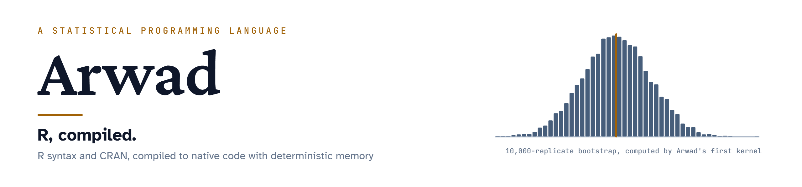

<h1 align="center">
  <picture>
    <source media="(prefers-color-scheme: dark)" srcset="docs/assets/arwad-banner-dark.png">
    <source media="(prefers-color-scheme: light)" srcset="docs/assets/arwad-banner-light.png">
    
  </picture>
</h1>

  
  
  
  
  

**A statistical programming language that keeps R's syntax and its package ecosystem, and compiles numerical work to native code with deterministic, garbage-collection-free memory.**

> **Status:** Phase 0 in progress · [bench/phase0/REPORT.md](bench/phase0/REPORT.md): called from R, a Goose bootstrap kernel is **1.59× faster** than R's fastest loop, allocates **46× less** memory in R, and matches GNU R within 3.7e-15 · MIT licence
>
> **Project lead:** Dr. Bashar Al Agha · [ORCID 0009-0004-5178-2345](https://orcid.org/0009-0004-5178-2345)

## The idea

R is the working language of statistics: CRAN alone hosts 25,504 packages (census of 24 October 2026, [research/](research/)). Its interpreter was designed for interactive analysis. Every value lives on a garbage-collected heap, modifying an object can copy it whole, and loops are slow unless rewritten in C or C++.

[Goose](https://github.com/aardappel/goose) (Apache-2.0, by Wouter van Oortmerssen) is a new systems language with **no heap at all**: values live inline on data stacks that the compiler assigns, leaving a scope is the free, and the compiler emits one plain C file. Goose functions marked `export fn` can be linked into a C program as a library, and slices cross the boundary as `{data, len}` without copying.

Arwad joins the two. People keep writing R. The parts of a program that do numerical work (resampling loops, iterative estimators, matrix kernels) are compiled through Goose into native code whose memory footprint is known before it runs.

## Why "Arwad"

Arwad is Syria's only inhabited island: the ancient Phoenician city of Arados, whose sailors carried the alphabet across the Mediterranean. Like Java and Kotlin, this language is named after an island. (Working title until 24 October 2026: R-Goose.)

## Architecture in brief

| Tier | Runs | Implementation |
|---|---|---|
| **Dynamic tier** | Everything R allows: closures, environments, lazy evaluation, S3/S4, `eval`, every CRAN package | Phases 1–3: GNU R itself, with Arwad shipped as an R package. Phase 4 onward: a new MIT-licensed R runtime with an R C-API compatibility layer |
| **Static tier** | Type- and shape-specialised numerical code | R function → typed IR → Goose → C → native code (TinyCC in-process, or clang/MSVC), called from R through `export fn` with zero-copy slices |

Full design: [docs/ARCHITECTURE.md](docs/ARCHITECTURE.md).

## "All of CRAN" is a design requirement

Of the 25,504 CRAN packages, 19,923 (78.1%) are pure R and 5,581 (21.9%) contain compiled code; 3,378 link to Rcpp. Arwad is compatible with all of them from its first release because its dynamic tier *is* GNU R, and acceleration is added underneath. The standalone runtime (Phase 4) must re-earn that compatibility package by package, measured nightly and published. See [docs/COMPATIBILITY.md](docs/COMPATIBILITY.md).

## Roadmap

| Phase | Deliverable | Exit criterion (measured, never assumed) |
|---|---|---|
| 0 Foundations | Goose toolchain, hand-written OLS and bootstrap kernels, benchmark and equivalence harnesses | A reproducible benchmark report against GNU R, with whatever result it shows |
| 1 Compiler slice | `arwad::aw_compile()` for the subset in [spec/subset-v0.md](spec/subset-v0.md) | 200 test functions compile and match GNU R within 1e-9 relative error |
| 2 Statistical engines | OLS/GLM, PLS-SEM with bootstrap, DEA, panel FE/RE, ARIMA/GARCH likelihoods, meta-analysis | Each engine matches its reference package on 50 datasets |
| 3 Parallel and WebAssembly | Share-nothing parallel resampling; browser build | 5,000-replicate bootstrap in the browser; methods paper submitted |
| 4 Standalone runtime | Arwad executable with its own evaluator and R C-API layer | At least 50% of CRAN passes its own examples and tests |
| 5 Full ecosystem | S4, Rcpp, graphics devices, Fortran, the long tail | At least 95%, then 99%, of CRAN |

Details, durations and dependencies: [docs/ROADMAP.md](docs/ROADMAP.md).

## Ground rules

1. **No unmeasured claims.** A speed-up is stated only with a reproducible benchmark and its raw data ([docs/BENCHMARK_METHOD.md](docs/BENCHMARK_METHOD.md)).
2. **Numerical equivalence first.** Compiled results are checked against GNU R, by default within 1e-9 relative error, with bit-identical random-number streams ([ADR-0004](docs/adr/0004-numerical-equivalence-gate.md)).
3. **Clean room.** No GNU R source code (GPL) is copied into this repository; behaviour is re-implemented from documentation and black-box tests ([docs/IP_AND_LICENSING.md](docs/IP_AND_LICENSING.md)).
4. **Credit where due.** Goose is the work of Wouter van Oortmerssen; R is the work of the R Core Team. Arwad builds on both and is affiliated with neither.

## Repository map

| Path | Contents |
|---|---|
| [docs/ARCHITECTURE.md](docs/ARCHITECTURE.md) | Two-tier design, compiler pipeline, risks, prior art |
| [docs/COMPATIBILITY.md](docs/COMPATIBILITY.md) | CRAN census and the compatibility strategy |
| [docs/ROADMAP.md](docs/ROADMAP.md) | Phases, tasks, exit criteria |
| [docs/IP_AND_LICENSING.md](docs/IP_AND_LICENSING.md) | Copyright, MIT, trademark, patent assessment, licence compatibility |
| [docs/AGENT_TEAM.md](docs/AGENT_TEAM.md) | The ten builder–verifier duets and how they are run |
| [docs/BENCHMARK_METHOD.md](docs/BENCHMARK_METHOD.md) | How performance is measured and reported |
| [docs/adr/](docs/adr/) | Architecture decision records |
| [spec/subset-v0.md](spec/subset-v0.md) | The R subset the Phase 1 compiler accepts |
| [research/](research/) | CRAN census data and the script that produces it |
| [bench/phase0/](bench/phase0/) | Phase 0 spike: R reference, Goose kernel, equivalence check, raw outputs and report |

## Licence

[MIT](LICENSE) © 2026 Bashar Al Agha. See [TRADEMARKS.md](TRADEMARKS.md) for use of the project name.
